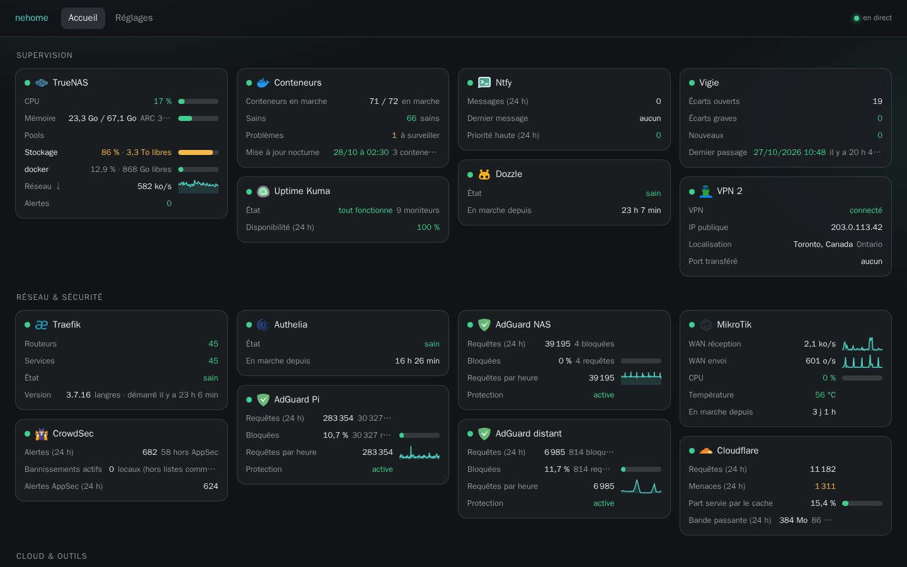
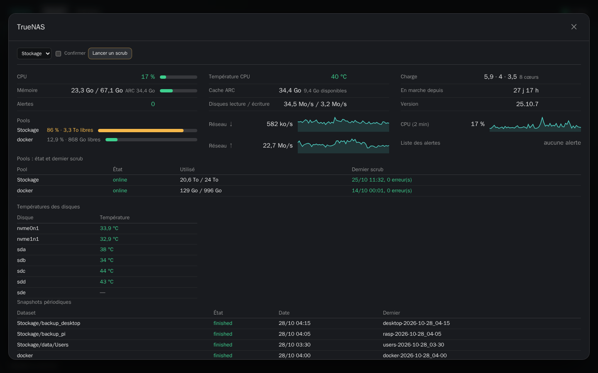

<div align="center">

# nehome

**A home dashboard that actually talks to your services.**

Self-hosted, written in Go. Each tile queries a service's API on the server, live in the browser,
with your keys never leaving the server.

[Français](README.fr.md) · [Configuration](docs/configuration.md) · [Integrations](docs/integrations/) · [Architecture](docs/architecture.md)

[](https://github.com/neotoxicfr/nehome/actions/workflows/ci.yml)



</div>

## Why nehome

Homepage, Homer, Heimdall and Homarr show links and a few counters. nehome goes further on the data:
queue progress, live transfer rates, pool usage, failing containers, blocked DNS queries, recent
imports, SMART temperatures… and lets you decide, field by field, what deserves a place on the tile.

- **Live.** Values stream over Server-Sent Events; rates refresh every 2–5 s.
- **Your layout.** On **Settings**, every field of every tile is *always visible*, *in the detail
  view* (opened by clicking the tile) or *hidden*, with its own order. Tiles have a position, and
  sections can be laid out as an aligned grid or in balanced columns.
- **Quick actions.** Buttons on the tile or in the detail view: refresh feeds, pause DNS blocking,
  restart a container or the VPN, unban an IP, test indexers, run a scheduled job, wake a PC…
  Admins only, logged, and the risky ones ask for confirmation.
- **Your brand.** Name, theme (dark, slate, OLED or light), accent colour and favicon, previewed live.
- **Configured without restarts.** Add, edit or remove a link from the UI, or edit `config.yaml`:
  it is re-read on the fly, and only the tiles that changed restart.
- **Secrets stay secret.** Keys come from Docker secrets or are typed once in the UI (stored 0600,
  never shown again). The browser only ever receives rendered HTML.
- **Light.** One static binary, about 35 MB of RAM and under 1 % of a CPU core with 45+ tiles. With no
  browser open, nothing is rendered and fast polling slows down to once a minute.
- **Locked down.** Authentication delegated to your proxy (Authelia, Authentik, oauth2-proxy…),
  strict Content-Security-Policy, integrations that only read unless you click an action,
  distroless non-root image.

<p align="center"></p>

## Integrations

68 types. One page each in [docs/integrations/](docs/integrations/), with options,
secret roles and the minimum rights to grant.

| Area | Types |
|---|---|
| System and OS | `system` (any Linux host, no agent), `docker`, `truenas`, `proxmox`, `synology`, `openmediavault`, `glances`, `netdata`, `portainer`, `scrutiny` |
| Network and security | `traefik`, `npm`, `crowdsec`, `authentik`, `adguard`, `pihole`, `opnsense`, `unifi`, `mikrotik`, `gluetun`, `wgeasy`, `cloudflare`, `tcp` |
| Monitoring | `uptimekuma`, `healthchecks`, `grafana`, `prometheus`, `speedtest`, `ntfy`, `gotify` |
| Media | `plex`, `jellyfin`, `emby`, `tautulli`, `tracearr`, `seerr` / `overseerr` / `jellyseerr`, `maintainerr`, `wizarr`, `audiobookshelf`, `navidrome`, `immich` |
| Downloads | `sonarr`, `radarr`, `lidarr`, `readarr`, `prowlarr`, `bazarr`, `jackett`, `crossseed`, `cleanuparr`, `qbittorrent`, `transmission`, `deluge`, `sabnzbd`, `nzbget`, `jdownloader` |
| Apps | `nextcloud`, `paperless`, `gitea` / `forgejo`, `frigate`, `homeassistant`, `minecraft`, `weather` |
| Generic | `link` (link + container state + HTTP probe), `customapi` (any JSON API, fields declared in YAML, optional POST button), `prometheus` |

Icons come from the [dashboard-icons](https://github.com/homarr-labs/dashboard-icons) library and
are guessed automatically; you can pick another one or hide it per tile.

> **Tested against real services:** truenas, qbittorrent, mikrotik, docker, link, weather, adguard,
> crowdsec, traefik, gluetun, uptimekuma, sonarr, radarr, jackett, crossseed, cleanuparr, nextcloud,
> ntfy, jdownloader, plex, tautulli, tracearr, seerr, maintainerr, wizarr, cloudflare, customapi,
> system, tcp. The others are tested
> against responses rebuilt from each service's documentation or source code and may need
> adjustments: reports from real setups are very welcome.

## Quick start

nehome expects to sit behind a reverse proxy that authenticates users and passes their name in a
header.

```yaml
# compose.yml
services:
  nehome:
    image: ghcr.io/neotoxicfr/nehome:latest
    restart: unless-stopped
    read_only: true
    security_opt: ["no-new-privileges:true"]
    cap_drop: [ALL]
    environment:
      - NEHOME_CONFIG=/data/config.yaml   # editable from the UI
    volumes:
      - ./data:/data                      # chown 65532:65532
    secrets: [sonarr_key]
secrets:
  sonarr_key: {file: ./secrets/sonarr_key}
```

```yaml
# data/config.yaml
auth:
  header: Remote-User
  trusted_proxies: [192.0.2.10/32]   # your reverse proxy
  admins: [alice]                    # who may edit links from the UI
tiles:
  - {id: sonarr, type: sonarr, title: Sonarr, section: Media,
     href: "https://sonarr.example.org", url: "http://sonarr:8989", secrets: {key: sonarr_key}}
```

Then open **Settings** to add more links (the form lists the options and keys each service needs)
and choose what each tile shows. A complete example: [compose.example.yml](compose.example.yml),
[config.example.yaml](config.example.yaml). Every option: [docs/configuration.md](docs/configuration.md).

To try it locally without a proxy, set `auth.disabled: true` and run
`go run ./cmd/nehome -config config.yaml`.

## Notes

- The interface is in **French** for now; the documentation exists in English and French.
- Each action can be shown on the tile, in the detail view or hidden, like the fields.
- Images are tagged `X.Y.Z` (no « v ») and `latest`; pin a version in production.

## Contributing

Bug reports, integration requests (with sample API responses) and pull requests are welcome. See
[CONTRIBUTING.md](CONTRIBUTING.md); security issues go through [SECURITY.md](SECURITY.md).

## License

[MIT](LICENSE)
